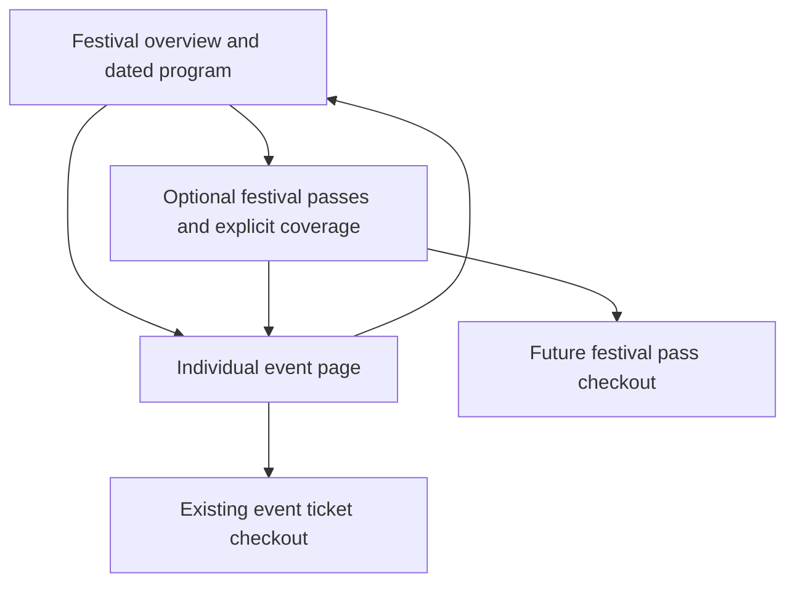

# Festival and event customer journey

Status: local interface prototype and proposed integration contract. The current
API has events and ticket types; it has no festival, festival membership or
festival-pass model. No API, payment, database or deployment changes accompany
this prototype.

Daniel's requirements:

- A festival brings together multiple events across multiple dates.
- Festival passes are optional.
- Individual event tickets are always sold within their individual event page.

## Customer experience

The festival page presents its identity, date range, venues and a program grouped
by date. Customers filter dates and venues, view event prices and availability,
and open an event page. The program has event-page links; event ticket quantity
controls stay on the event page. Each event continues to have its own title,
description, date/time, venue, ticket inventory and admission details.

A child event displays its parent festival and a route back to the program.
When passes are offered, it names the passes covering that event or makes its
exclusion clear. The event ticket selector remains available even when a pass
also covers the event. A pass is a separate purchase choice, so an event ticket
never implies admission to the rest of the festival.

When passes are enabled and published, the festival has a separate pass selector
with explicit included events, excluded events, quantity limits and subtotal.
Changing the pass updates the coverage labels in the program. Coverage is based
on explicit event membership, not a pass name or an assumption that a weekend
pass covers every event. Turning pass sales off removes the pass section and
coverage messaging; the full-width event program remains.

## Review the local prototype

| Scenario | Local route |
| --- | --- |
| Festival with weekend and Saturday passes | `/preview/festival` |
| Festival selling event tickets only | `/preview/festival?passes=none` |
| Saturday program | `/preview/festival?date=2027-11-20` |
| Individual festival event | `/preview/festival/events/neon-nights-preview` |
| Existing preview entry, now with festival context | `/preview/event-onsale` |

The fictional Signal Weekender has six events over three dates and three venues.
Its weekend pass includes five events; its Saturday pass includes two. Rooftop
Sessions is separately ticketed and sold out. The late Friday show uses a
Saturday UTC timestamp but appears under Friday in Newfoundland local time.
All names, dates, prices and stock in these fixtures are illustrative.

Preview configuration links let reviewers compare pass-enabled and event-only
layouts. Date, venue, pass selection and configuration are retained in URL query
parameters when entering a child event and returning. Event pages open at the
top; return links focus the program or pass section. Sample event purchases and
festival-pass purchases are disabled. The preview never sends pass products to
the existing event-order endpoint.

## Proposed application model

| Entity | Responsibility |
| --- | --- |
| Festival | Identity, slug, description, artwork, organizer, canonical program timezone, published state and optional pass-sales setting. |
| Festival event membership | Explicit festival/event relationship, program order and public membership. Existing events own schedules, venues and ticket types. |
| Festival pass product | Name, price/currency, sale window, per-order cap, stock and an explicit, versioned list of covered event admissions. |
| Pass coverage | Covered event ID and eligible admission ticket type/level. This distinguishes general admission from balcony, VIP or other products. |
| Festival pass purchase | Dedicated pass purchase/fulfillment path, with idempotent payment recovery and an immutable coverage snapshot. Existing event orders remain scoped to their event. |
| Pass admission entitlement | One admission right per covered event, with event-specific check-in and revocation state. |

These are proposed backend concepts, not added Prisma models. The public-view
functions accept data shaped for this separation; development fixtures supply
the missing adapter today. A real event payload can supply its optional festival
context once the relationship is available.

## Integration sequence

1. Add festival membership and a read-only public festival endpoint. Return only
   published customer-visible members, the canonical timezone, organizer/artwork,
   event-page paths, current event availability and optional published passes.
   Add optional parent festival context to public event responses.
2. Connect the festival view and event context to those responses. Preserve
   independent `/e/:slug` event pages and the existing event checkout path.
   Keep pass sales disabled until dedicated fulfillment exists.
3. Add pass products and explicit coverage tied to admission types. Publish the
   exact included events/entry level so general admission coverage does not
   promise balcony or VIP access. Version coverage and snapshot it on purchase.
4. Implement pass reservations and payment recovery. Recommended default:
   atomically hold one admission allocation at every covered event plus pass
   stock. All allocations succeed together; expiration and payment failure
   release all holds idempotently. Individual ticket sales consume the same
   covered-event capacity. Any alternative reserved allocation pool needs an
   explicit operator configuration.
5. Fulfill event-specific entitlements and extend wallet/scanning. A pass can be
   checked into different covered events, once at each event according to its
   admission rules. Consuming it at the first event must preserve later rights.
   Duplicate scans, revoked passes and uncovered events must be rejected.
6. Add operator configuration: festival identity, member events, program order,
   optional pass products, coverage and sale windows. Coordinate child changes,
   pass coverage changes and cancellation notifications. Refund/cancellation
   outcomes follow approved business policy rather than assumptions in the UI.

Production pass activation needs acceptance coverage for last-ticket races
between event and pass sales, all-or-nothing holds, expiry, duplicate webhooks,
partial fulfillment recovery and event-specific scanner admission. Those flows
remain future backend work.

## Local ownership and evidence

Worktree: `tixmo-event-onsale`; branch:
`codex/customer-event-onsale-2026-10-20`; this increment starts at `ffff2b3`.
Owned changes: storefront UI/styles, preview-only festival fixtures and routes,
focused frontend tests, and this document. No board activity is claimed; the
local kanban CLI is unavailable. Carry exact reviewed SHA and verification into
the eventual integration PR.

The prototype reuses `StorefrontBrand`, `StorefrontButton`, existing storefront
tokens, the actual unchanged Tixmo PNG and the existing generated sample image.
No new or altered logo/artwork was created. Preview routes and fixtures are
excluded from production JavaScript. Independent exact-commit review and local
test/build/browser evidence are recorded with the implementation handoff.

Verification on 2026-10-20: full frontend suite 35 files / 230 tests passed.
Focused festival checks passed again after the admission-level copy was added.
Production build and design guard passed with the unchanged 926-entry baseline.
Desktop 1440px and mobile 390px festival layouts were visually inspected.
Independent review of `51822e560ae598f272f9a8e2bb6ec74f0bccee2a` passed
19 tests across 3 files, a production build and a production-JavaScript isolation
scan. The one introduced finding was the hero link's text color overriding the
button foreground. The follow-up sets button-style links explicitly to white,
restoring 4.70:1 text contrast, and is submitted for exact-commit re-review.
Browser checks confirm child pages open at the top, the pass-coverage return
link focuses the pass panel, the event-only layout has six event links and no
pass selector, and widths from 320px through 1440px have no horizontal overflow.
